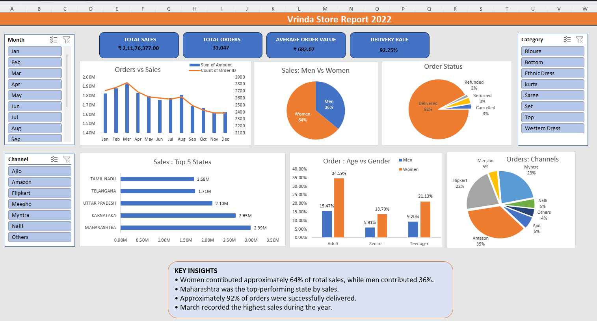

# Vrinda Store Sales Analysis (Excel Dashboard)

An Excel dashboard project analyzing **2022 sales data for Vrinda Store**, an online fashion retailer selling through channels such as Amazon, Myntra, and Ajio.

The dashboard uses PivotTables, PivotCharts, slicers, and KPI cards to explore sales performance, customer demographics, order status, and sales channels.

## 📊 Dashboard Preview

## 🎯 Business Questions

* How do sales and orders change month by month?
* Who buys more: men or women, and which age groups contribute most to sales?
* Which states and sales channels generate the most revenue?
* What proportion of orders is delivered, cancelled, returned, or refunded?

## 📁 Dataset

* **Period:** January–December 2022
* **Records:** 31,047, as counted in the project workbook
* **Source file:** `data/Vrinda_Store_Data.xlsx`
* **Data fields:** Order ID, Customer ID, Gender, Age, Age Group, Date, Month, Status, Channel, SKU, Category, Size, Quantity, Amount, Shipping City, Shipping State, and other fields.

The dashboard workbook also contains the source data in the `Vrinda Store` worksheet.

## 📈 Key Performance Indicators (KPIs)

| KPI                 | Overall Value |
| ------------------- | ------------: |
| Total Sales         |  ₹2,11,76,377 |
| Total Orders        |        31,047 |
| Average Order Value |       ₹682.07 |
| Delivery Rate       |        92.25% |

## 🔍 Key Insights

* **Women contribute the largest share of sales:** approximately 64%, compared with 36% from men.
* **Adult women are an important customer segment**, contributing a substantial share of orders.
* **March recorded the highest monthly sales** in the analysis.
* **Maharashtra ranked among the top-performing states** by sales.
* **Approximately 92.25% of orders were delivered**, according to the workbook's delivery-rate calculation.

*Note: These insights should be checked against the workbook's charts and calculations before being treated as final findings.*

## 🛠️ Excel Skills Used

* Data cleaning and preparation
* Excel formulas and helper columns
* PivotTables and PivotCharts
* Interactive slicers and PivotTable Report Connections
* KPI calculations
* Dashboard layout, formatting, and visualization
* Business insights and sales reporting

## 🚀 How to Use

1. Open the `excel/` folder in this repository.
2. Download `Vrinda_Store_Sales_Analysis.xlsx`.
3. Open the workbook using the desktop version of Microsoft Excel.
4. Navigate to the **Vrinda Store Annual Report** worksheet.
5. Explore the charts and use the available slicers to filter the dashboard.

**Note:** GitHub cannot display the Excel dashboard's interactive features directly. Download and open the workbook in Excel to explore it.

📂 Project Structure
vrinda-store-sales-analysis/
├── README.md
├── excel/
│   └── Vrinda_Store_Sales_Analysis.xlsx
├── data/
│   └── Vrinda_Store_Data.xlsx
└── images/
    └── dashboard.png

## 🙏 Credits

* **Dataset and project inspiration:** [Rishabh Mishra's Excel Dashboard Tutorial](https://youtu.be/gTK5rNhWJyA)
* **Project work:** Excel dashboard creation, KPI summaries, formatting, and documentation.

This project was developed as part of my learning journey in data analytics, using a tutorial as a learning reference.

## 👩‍💻 Author

**Rutuja Kashid**

* **LinkedIn:** [www.linkedin.com/in/rutuja-kashid-738ba527b](https://www.linkedin.com/)
* **Email:** [kashidrutuja809@gmail.com](mailto:kashidrutuja809@gmail.com)
